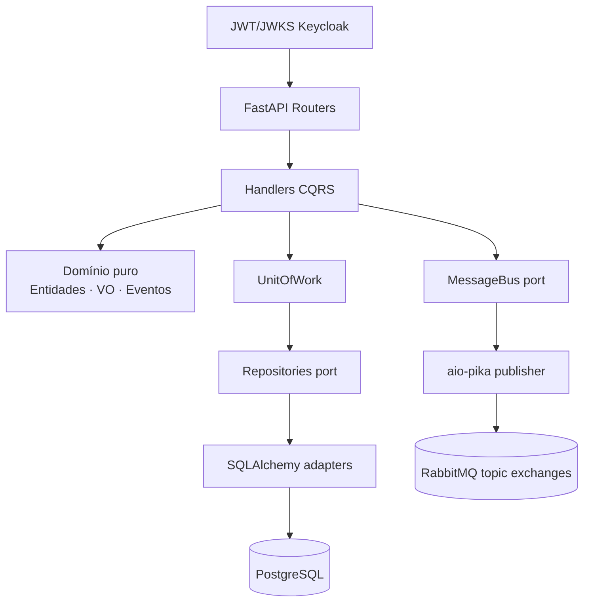
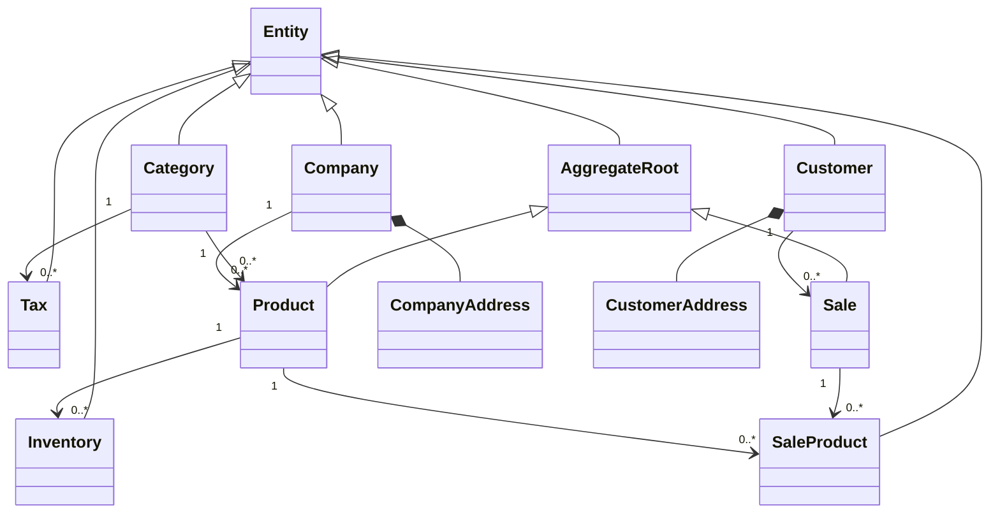

# e-Estoque-Python (e-Estoque API)

Migração do **e-Estoque-API (.NET 8 / C#)** para **Python 3.14 + FastAPI**, guiada por
Specification-Driven Development (SDD). Não é uma tradução mecânica: os requisitos e regras foram
extraídos do código/testes .NET e reimplementados como um backend Python idiomático, preservando o
contrato HTTP, o schema PostgreSQL e o wire format do RabbitMQ.

```text
Sistema .NET  →  Requisitos  →  Especificação (docs/sdd)  →  Arquitetura Python  →  Testes  →  Paridade
```

## Arquitetura

**Modular Monolith orientado a domínio** — Clean Architecture + DDD + CQRS + Ports & Adapters,
async ponta a ponta (SQLAlchemy 2 / asyncpg / aio-pika / redis.asyncio / httpx).





### Bounded contexts

`product` (Category+Product) · `company` · `customer` · `inventory` · `sale` · `tax` · `identity`
— cada um com `domain/ application/ infrastructure/ api/`, mais `shared/` (kernel) e
`filtering/` (Gridify + OData → SQLAlchemy, com whitelist, **sem `eval`**).

## Stack

Python 3.14 · FastAPI · Pydantic v2 (+ Settings) · SQLAlchemy 2 async · asyncpg · Alembic ·
PostgreSQL 17 · aio-pika · redis-py · Keycloak (JWT via JWKS, PyJWT) · odata-query (OData `$filter`)
· prometheus-fastapi-instrumentator (métricas) · OpenTelemetry (opcional, extra `[otel]`) ·
pytest(+asyncio, cov) · Testcontainers · Ruff · mypy `strict` · uv.

## Requisitos

- Python 3.14 (o `uv` instala automaticamente: `uv python install 3.14`)
- Docker (para PostgreSQL/Redis/RabbitMQ/Keycloak locais e testes de integração)

## Setup

```bash
uv sync                       # ambiente reproduzível via uv.lock
uv run alembic upgrade head   # cria o schema (paridade da migration EF 20250327000516_001)
cp .env.example .env          # configure segredos
uv run fastapi dev src/e_estoque/main.py     # ou:
uv run uvicorn e_estoque.main:app --reload --port 8000
```

Infra completa (API + PostgreSQL + Redis + RabbitMQ + Keycloak + Prometheus + Grafana + Loki + Tempo):

```bash
docker compose up -d --build
curl http://localhost:8000/health       # "Healthy" (paridade .NET)
curl http://localhost:8000/health/ready
curl http://localhost:8000/health/live
```

## Qualidade (gate único)

```bash
./scripts/verify.sh     # ruff + format + mypy strict + alembic offline + pytest --cov
```

## Testes

```bash
uv run pytest tests/unit        # domínio, handlers (fakes), parsers, arquitetura
uv run pytest tests/api         # contratos HTTP (ASGI + SQLite in-memory p/ comportamento)
EESTOQUE_SKIP_DOCKER=0 uv run pytest tests/integration   # Testcontainers (PG/RabbitMQ reais)
```

## API (contrato do .NET preservado)

| Grupo | Rotas | Observações de paridade |
| --- | --- | --- |
| Auth (anônimo) | `POST /api/Auth/login` · `/refresh_token` · `/register` | proxy ao token endpoint/Admin API do Keycloak; falhas → 403 |
| Recursos | `/api/{Categories,Companies,Customers,Inventories,Products,Sales,Taxs}` + `/gridify` + `/{id}` | leitura: JWT; escrita: role `Create` |
| Status | POST Categories → **201+Location**; demais POST → 200; PUT → 200; DELETE → 200 `{}` | paridade dos controllers .NET |
| Envelope | `{success, message, data, pagedResult{...}}` (camelCase, página 1-based) | `BaseResult/BaseResultList/PagedResult` |
| Erros | `{"error": msg}` (400/401/403/404/422/500) | `ExceptionMiddleware` |
| OData | `/odata/{Sets}` com `$filter/$orderby/$top/$skip/$count/$select`, `/$count`, `Set(key)`, `/$metadata` | subset seguro (ADR-013, `$filter` via `odata-query`), `$top≤1000` |
| Ops | `/health` · `/health/live` · `/health/ready` · `/metrics` · `/docs` · `/openapi.json` | |

## Documentação SDD

- `docs/sdd/` — inventário de fontes, sistema atual, requisitos (FR/NFR), domínio, contratos
  (API/dados/segurança/eventos), plano de migração/testes, **matrizes de paridade** e
  `ASSUMPTIONS.md`/`MIGRATION-DIFFERENCES.md` (bugs preservados vs corrigidos).
- `docs/adr/ADR-001…014` — decisões (Python 3.14, CQRS sem MediatR, sem outbox, OData subset…).
- `docs/MIGRATION_FROM_DOTNET.md` — guia conceitual C# → Python para estudo.

## Observabilidade

- `/metrics` Prometheus (requests, latência p50/p95/p99 via histograma, erros, pool, bus).
- Tracing OpenTelemetry → OTLP (Tempo) ativável via `EESTOQUE_OTLP_ENDPOINT` (extra `[otel]`).
- Logs JSON estruturados (`request_id` via `contextvars`, sanitização de dados sensíveis).
