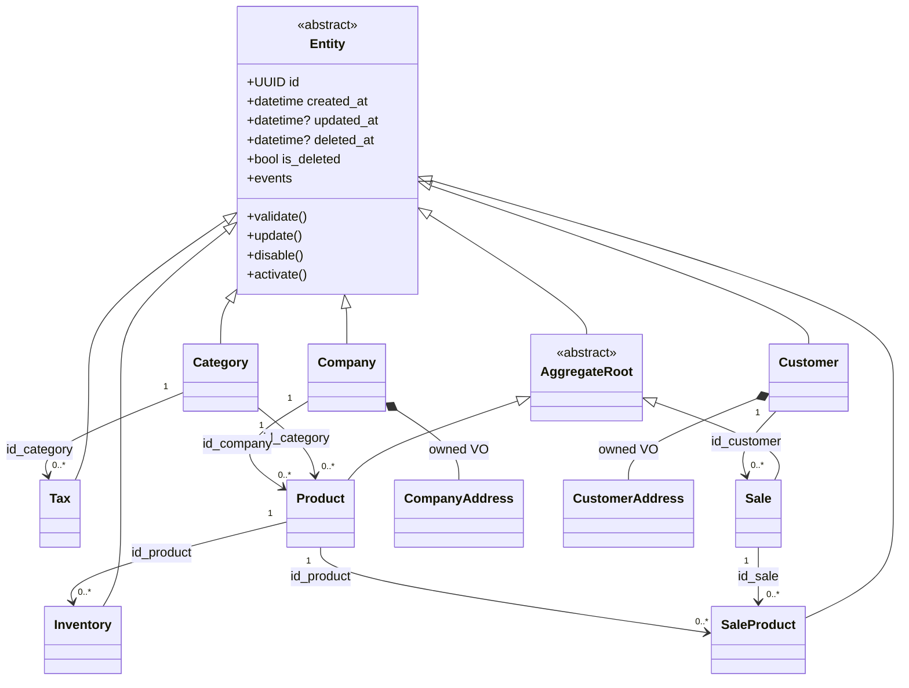

# 04 — DOMAIN MODEL

Domínio extraído de `e-Estoque-API.Core` (100% das entidades, sem inferência).

## Diagrama

## Entidades (Python — `dataclass(slots=True)`)

Convenções: `id: UUID = uuid4()`, timestamps UTC-aware em memória (persistidos naive-UTC por paridade de
coluna), `validate() -> None` levanta `DomainValidationError` com a lista de mensagens **idênticas** às do
FluentValidation .NET. Eventos acumulam em `events: list[DomainEvent]` (imutáveis, `frozen=True`).

| Entidade | Campos (tipo) | Invariantes (mensagens .NET preservadas) |
| --- | --- | --- |
| `Category` | name, description, short_description: str | name 3–80; short_description 3–500; description 3–5000; base: id≠nil, created_at ∈ [1900,3000] |
| `Company` | name, doc_id, phone_number: str(3–80); email, description: str(3–250); company_address: CompanyAddress | endereço: todos os campos 3–80 exceto **longitude (sem regra)** |
| `Customer` | mesmos campos de Company + customer_address | idem Company |
| `Inventory` | quantity: int, date_order: datetime, id_product: UUID | quantity > 0; date_order obrigatória; id_product ≠ vazio |
| `Product` | name(3–250), description(3–500), short_description(3–250), image(3–5000): str; price, weight, height, length: Decimal > 0; id_category, id_company: UUID | AggregateRoot |
| `Sale` | quantity: int > 0; total_price, total_tax: Decimal > 0 (total_tax=0 é inválido — paridade); sale_type: SaleType (1\|2); payment_type: PaymentType (1–4); delivery_date, sale_date, payment_date: datetime obrigatórios; id_customer: UUID; sale_products: list[SaleProduct] | AggregateRoot; 1 `SaleProduct` por produto informado (quantity = quantity da venda) |
| `SaleProduct` | quantity: int (sem regra — paridade); id_product, id_sale: UUID ≠ vazio | **não** valida campos base (paridade) |
| `Tax` | name(3–80), description(3–250); percentage: Decimal ∈ [0,100]; id_category: UUID | |

Base `Entity.update()` → `updated_at = now`; `disable()` → `is_deleted=True, deleted_at=now`; `activate()` inverso.

## Value Objects (frozen dataclasses, validados pela entidade dona)

- `CompanyAddress(street, number, complement, neighborhood, district, city, country, zip_code, latitude, longitude)`
- `CustomerAddress` — mesmos 10 campos.

## Enums

- `SaleType(IntEnum)`: UNITARY=1, RECURRENT=2 (parse inválido → UNITARY, paridade de `SaleTypeHelper`).
- `PaymentType(IntEnum)`: PIX=1, DEPOSIT=2, CREDIT_CARD=3, DEBIT_CARD=4 (parse inválido → PIX).

## Eventos de domínio (imutáveis; nomes no passado, payload .NET preservado)

| Evento | Payload |
| --- | --- |
| CategoryCreated/Updated | id, name, description, short_description |
| CompanyCreated/Updated | id, name, doc_id, email, description, phone_number, company_address |
| CustomerCreated/Updated | id, name, doc_id, email, description, phone_number, customer_address |
| InventoryCreated/Updated | id, quantity, date_order, id_product |
| ProductCreated | id, name, description, short_description, price, weight, height, length, id_category, id_company (**sem image** — paridade) |
| ProductUpdated | idem ProductCreated (parâmetro `image` é descartado — paridade do bug) |
| SaleCreated/Updated | id, quantity, total_price, total_tax, sale_type, payment_type, delivery_date, sale_date, payment_date, id_customer, products |
| TaxCreated/Updated | id, name, description, percentage, id_category |
| NotificationError | event_name, description (falhas de handler → exchange `noticiation-service`) |

## Ports (Protocol) — application layer

- `CategoryRepository`, `CompanyRepository`, `CustomerRepository`, `InventoryRepository`, `ProductRepository`,
  `SaleRepository`, `SaleProductRepository`, `TaxRepository` — métodos: `add`, `get_by_id`, `all` (com/sem
  filtro de deleted), `find`, `update`, `remove` (hard), `disable`/`activate` (soft), `search` (filtro,
  ordenação, includes, paginação 1-based, count), `count`, `exists`, `query_all` (para gridify/OData).
- `MessageBus.publish(event, routing_key, exchange)`.
- `UnitOfWork` (async context manager; commit/rollback) — **evolução** sobre o .NET (que não tinha UoW);
  semanticamente equivalente a 1 transação por operação de repositório (ver ADR-004/ADR-010).

## Multi-tenancy

Somente `Product.id_company` (FK obrigatória). Não há filtro global de tenant no .NET; isolamento
empresa-empresa **não existe** no sistema original → não inventado (decisão conservadora, ver `ASSUMPTIONS.md`).
